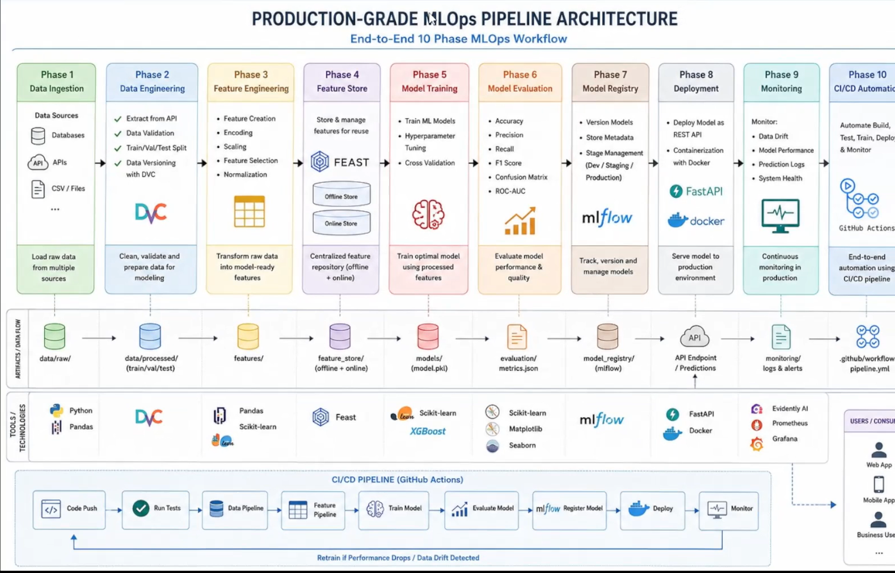

\# Customer Churn Prediction – End-to-End MLOps


An end-to-end MLOps project that predicts customer churn using Machine Learning and automates the model lifecycle, from data ingestion and versioning to deployment, monitoring, and CI/CD.


\## Project Overview


Customer churn prediction helps businesses identify customers who are likely to stop using their services. This project implements a complete MLOps workflow to build, evaluate, deploy, and monitor a machine learning model.


The project uses Logistic Regression to predict customer churn and integrates tools such as DVC, AWS S3, Feast, MLflow, FastAPI, Docker, Evidently AI, and GitHub Actions.


\## Architecture

The following diagram illustrates the complete end-to-end MLOps architecture implemented in this project.

<p align="center">
  
</p>


The project follows a 10-phase MLOps workflow:


1\. Data Ingestion

2\. Data Engineering and Versioning

3\. Feature Engineering

4\. Feature Store

5\. Model Training

6\. Model Evaluation

7\. Model Registry

8\. Model Deployment

9\. Model Monitoring

10\. CI/CD Automation


\## Technology Stack


| Category | Tools |

|---|---|

| Programming | Python |

| Data Processing | Pandas, NumPy |

| Machine Learning | Scikit-learn |

| Experiment Tracking | MLflow |

| Data Versioning | DVC |

| Cloud Storage | AWS S3 |

| Feature Store | Feast |

| API Development | FastAPI |

| Containerization | Docker |

| Cloud Deployment | AWS EC2, Amazon ECR, AWS SSM |

| Monitoring | Evidently AI |

| CI/CD | GitHub Actions |

| Testing | Pytest |


\## Project Structure


```text

mlops-customer-churn/

│

├── .github/

│   └── workflows/

│       └── ci.yml

│

├── data/

│   ├── raw/

│   ├── processed/

│   ├── experimental/

│   └── monitoring/

│

├── feature\_store/

│   └── feature\_repo/

│

├── models/

│   └── experimental/

│

├── reports/

│   └── model\_evaluation/

│

├── src/

│   ├── data\_ingestion/

│   ├── data\_processing/

│   ├── feature\_engineering/

│   ├── model\_training/

│   ├── model\_evaluation/

│   ├── api/

│   └── monitoring/

│

├── tests/

│

├── Dockerfile

├── .dockerignore

├── .dvc/

├── requirements.txt

├── requirements-dev.txt

└── README.md

```


\*Note: This is a high-level representation; some generated data, artifacts, and configuration files are omitted.\*


\## MLOps Workflow


\### Phase 1 – Data Ingestion


\- Generated and ingested customer churn data.

\- Stored raw data for subsequent processing.

\- V3 experimental dataset contains 5,000 customer records.


\### Phase 2 – Data Versioning


\- Integrated DVC for dataset version control.

\- Configured Amazon S3 as remote storage.

\- Pushed versioned data artifacts to S3.


\### Phase 3 – Feature Engineering


\- Processed customer information and prepared model features.

\- Applied categorical encoding.

\- Removed `customer\_id` from model input features.

\- Prepared training, validation, and testing datasets.


\### Phase 4 – Feature Store


\- Integrated Feast as the feature store.

\- Defined feature views and a feature service.

\- Materialized features into the online store.

\- Used Feast to retrieve customer features for API predictions.


\### Phase 5 – Model Training


\- Trained machine learning models using Scikit-learn.

\- Compared model performance.

\- Selected Logistic Regression as the preferred V3 model.


\### Phase 6 – Model Evaluation


Evaluated the model using:


\- Accuracy

\- Precision

\- Recall

\- F1-score

\- ROC-AUC


The classification threshold is configured to \*\*0.34\*\*, balancing precision and recall for the project's evaluation objective.


\### Phase 7 – Model Registry


\- Integrated MLflow for experiment tracking and model management.

\- Registered the Logistic Regression model.

\- Used model versions and aliases to manage candidate and champion models.

\- Implemented a model quality gate before promotion.


\### Phase 8 – Model Deployment


\- Developed a prediction API using FastAPI.

\- Containerized the application using Docker.

\- Published Docker images to Amazon ECR.

\- Deployed the application on AWS EC2.

\- Used AWS Systems Manager (SSM) for deployment and remote access.


\*\*API endpoints:\*\*


| Method | Endpoint | Description |

|---|---|---|

| GET | `/` | API information |

| GET | `/health` | Health check |

| POST | `/predict` | Predict using supplied features |

| POST | `/predict/{customer\_id}` | Predict using a customer ID and Feast features |


\### Phase 9 – Model Monitoring


Integrated Evidently AI and custom monitoring scripts to monitor:


\- Feature data drift

\- Prediction logs

\- API request logs

\- API response times

\- Drift alerts


The current drift demonstration compares the V3 training dataset against the held-out V3 test dataset.


\*\*Recorded demonstration result:\*\*

\- Features checked: 16

\- Drifted features: 0

\- Drift share: 0.0

\- Drift detection threshold: 0.50


This result indicates that no drift was detected in that comparison. It is a dataset-based demonstration, not proof of continuous live-production drift monitoring.


\### Phase 10 – CI/CD Automation


Implemented GitHub Actions to automate the deployment workflow.


The pipeline includes:


1\. Checkout source code.

2\. Set up Python.

3\. Install dependencies.

4\. Configure AWS credentials through GitHub Secrets.

5\. Pull required data from DVC remote storage.

6\. Apply and materialize Feast features.

7\. Run automated API tests.

8\. Build the Docker image.

9\. Push the image to Amazon ECR.

10\. Deploy to EC2 through AWS SSM.

11\. Perform a health check and support rollback on deployment failure.


\## Installation and Setup


\### 1. Clone the repository


```bash

git clone https://github.com/albinsibi2025-stack/mlops-customer-churn.git

cd mlops-customer-churn

```


\### 2. Create a virtual environment


Windows PowerShell:


```powershell

python -m venv .venv

.venv\\Scripts\\Activate.ps1

```


\### 3. Install dependencies


```powershell

pip install -r requirements-dev.txt

```


\### 4. Retrieve versioned data


Configure the required AWS credentials and DVC remote access, then run:


```powershell

dvc pull

```


\### 5. Run automated tests


```powershell

pytest tests/ -v

```


\## Running the API Locally


Start the FastAPI application using:


```powershell

uvicorn src.api.app:app --host 0.0.0.0 --port 8000

```


Open the interactive API documentation:


```text

http://127.0.0.1:8000/docs

```


Check API health:


```text

http://127.0.0.1:8000/health

```


\## Running Data Drift Detection


Prepare the monitoring dataset:


```powershell

python src/monitoring/prepare\_monitoring\_data.py

```


Run the drift detection script:


```powershell

python src/monitoring/data\_drift.py

```


Open the generated HTML report:


```powershell

Invoke-Item reports/data\_drift\_report.html

```


\## CI/CD Pipeline


The GitHub Actions workflow is located at:


```text

.github/workflows/ci.yml

```


The workflow is configured to run on pushes to the main branch, pull requests targeting main, and manual execution.


AWS credentials and deployment configuration should be stored securely in GitHub Secrets. Never commit AWS access keys, secret keys, or passwords to the repository.


\## Cloud Infrastructure


The project uses the following AWS services:


\- \*\*Amazon S3:\*\* DVC remote storage.

\- \*\*Amazon ECR:\*\* Docker image repository.

\- \*\*Amazon EC2:\*\* API hosting.

\- \*\*AWS Systems Manager:\*\* Remote deployment and management.

\- \*\*Amazon ECS Fargate:\*\* Used during deployment experiments; the service was scaled to zero running tasks.


Cloud resources may incur charges while active.


\## Future Improvements


\- Implement continuous monitoring using real production traffic.

\- Configure a shared persistent online feature store for scalable deployment.

\- Add automated model retraining when significant drift is detected.

\- Expand integration and deployment testing.

\- Improve prediction monitoring and alerting.

\- Add production-grade authentication and API security.

\- Implement more comprehensive cloud infrastructure automation.


\## Author


\*\*Albin Sibi\*\*


\- GitHub: \[albinsibi2025-stack](https://github.com/albinsibi2025-stack)

\- Project: \[mlops-customer-churn](https://github.com/albinsibi2025-stack/mlops-customer-churn)


\## License


Add a license file if you intend to distribute this project under a specific open-source license.

